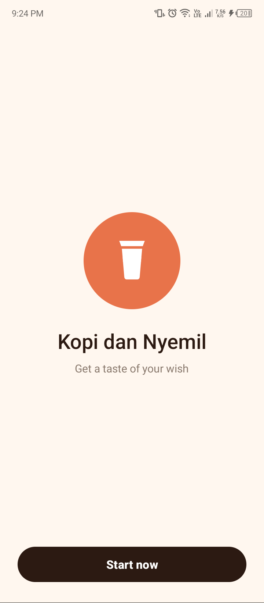
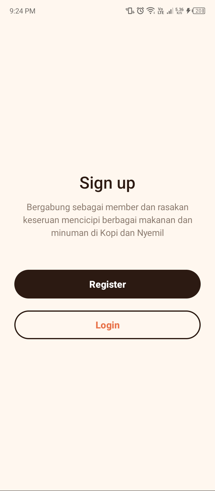
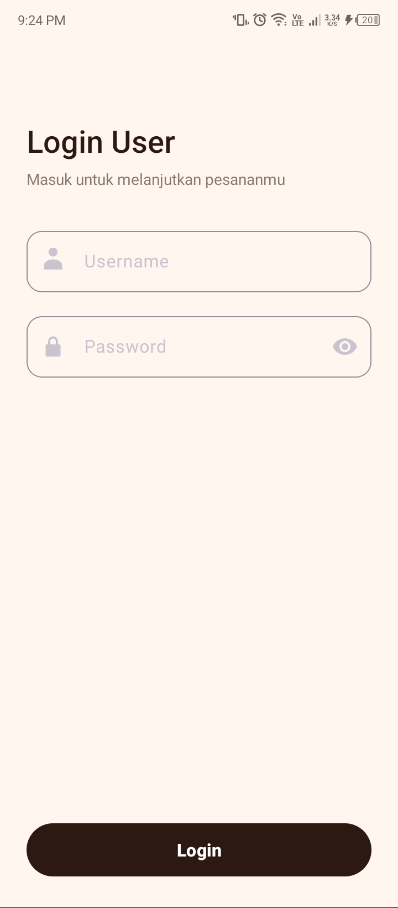
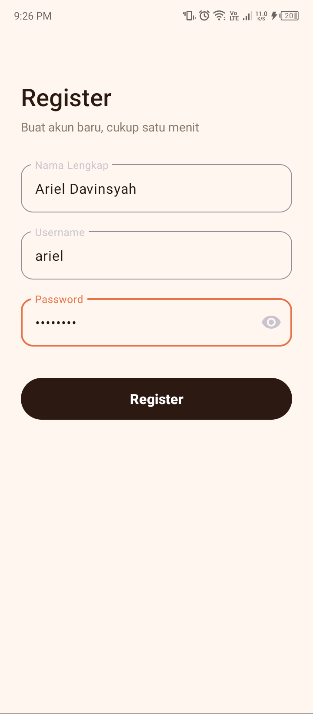
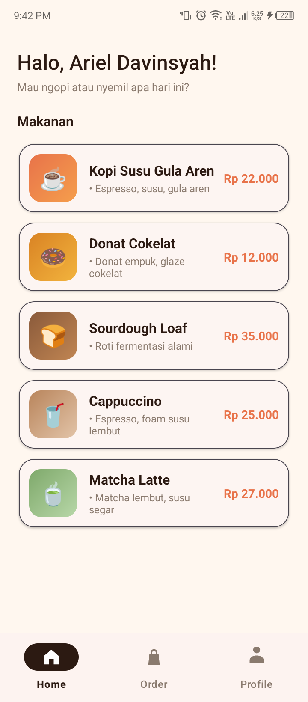
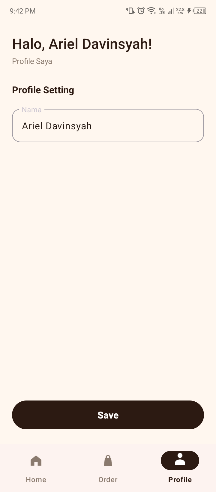
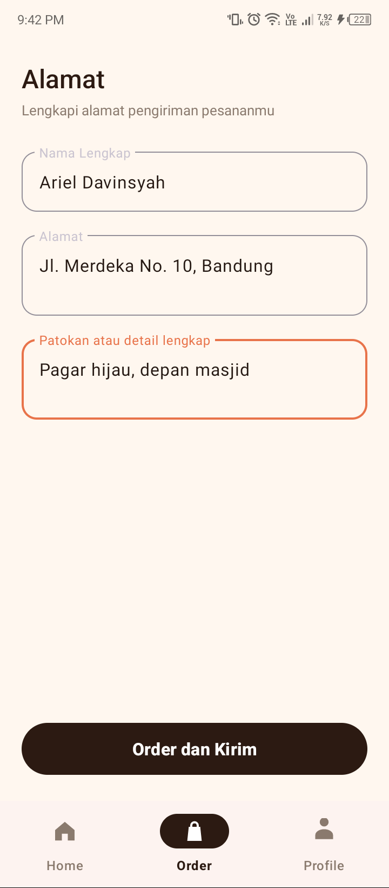
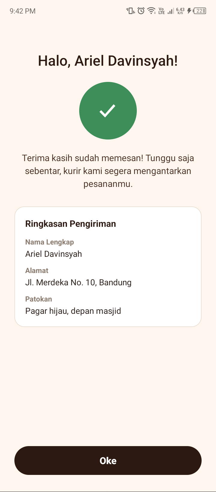

# ☕ Kopi dan Nyemil

Aplikasi mobile pemesanan kopi dan camilan, dibuat sebagai tugas UTS mata kuliah **Pengembangan Aplikasi Mobile**. Aplikasi mengimplementasikan seluruh wireframe yang diberikan: Splash/Welcome, Sign Up, Login, Register, Home, Profile, Alamat Pengiriman, dan Konfirmasi Pesanan, dengan tampilan yang dipoles agar lebih modern dan nyaman dipakai.

> **Identitas mahasiswa**
> Nama: M. Ariel Davinsyah Putra
> NIM: 1247050122 · Kelas: B
> Mata kuliah: Pengembangan Aplikasi Mobile

---

## ✨ Fitur

| # | Layar | Fitur |
|---|-------|-------|
| 1 | Splash / Welcome | Logo, nama aplikasi, tagline "Get a taste of your wish", tombol **Start now**, auto-lanjut ke Sign up setelah 3 detik |
| 2 | Sign Up | Halaman pilihan awal: tombol **Register** dan **Login** |
| 3 | Login | Input username dan password (tersamarkan), validasi wajib isi |
| 4 | Register | Input nama lengkap, username, password, validasi wajib isi; nama tersimpan untuk sapaan aplikasi |
| 5 | Home | Sapaan "Halo, [nama]", daftar **5 menu** makanan/minuman (kartu dengan harga), bottom navigation |
| 6 | Profile | "Profile Saya", ubah nama, tombol **Save**; sapaan di seluruh aplikasi ikut berubah |
| 7 | Alamat Pengiriman (tab Order) | Nama lengkap, alamat, patokan/detail, tombol **Order dan Kirim**, validasi wajib isi |
| 8 | Konfirmasi Pesanan | Tanda sukses, ucapan terima kasih, ringkasan alamat pengiriman, tombol **Oke** kembali ke Home |

- **Bottom navigation** 3 tab: Home, Order, Profile (tab aktif ditandai pil gelap).
- **Tanpa database** sesuai ketentuan tugas: seluruh data memakai data statis (dummy) yang tersimpan di memori.
- Desain palet hangat kedai kopi (espresso, oranye, krem), kartu membulat, tombol pill.

## 📱 Screenshot

| Splash | Sign Up | Login | Register |
|:---:|:---:|:---:|:---:|
|  |  |  |  |

| Home | Profile | Alamat Pengiriman | Konfirmasi Pesanan |
|:---:|:---:|:---:|:---:|
|  |  |  |  |

*Screenshot diambil langsung dari ponsel Android fisik (TECNO LG7n, Android 12) memakai data dummy.*

*Dokumentasi desain dan alur lengkap tersedia di [docs/kopi-dan-nyemil/index.html](docs/kopi-dan-nyemil/index.html). Laporan pengujian ada di [docs/reports/kopi-dan-nyemil/index.html](docs/reports/kopi-dan-nyemil/index.html).*

## 🛠 Teknologi yang Digunakan

- **Kotlin** sebagai bahasa pemrograman utama
- **Android SDK** (native), `minSdk 26`, `target/compileSdk 36`
- **XML Layout + ViewBinding** untuk tampilan
- **Material Design 3** (MaterialCardView, TextInputLayout, BottomNavigationView, MaterialButton)
- **Gradle 9.1 + AGP 8.13** sebagai build system
- Tanpa library pihak ketiga selain AndroidX/Material bawaan, tanpa database

## 🚀 Cara Menjalankan Aplikasi

**Kebutuhan:** Android Studio (disarankan) atau Android SDK + JDK 17.

1. Clone repositori ini:
   ```bash
   git clone https://github.com/putmarildav-stack/UTSArielDavinsyahPAM.git
   cd UTSArielDavinsyahPAM
   ```
2. Buka folder proyek di **Android Studio**, tunggu proses Gradle Sync selesai.
3. Pilih emulator atau perangkat fisik, lalu tekan **Run** ▶️.

Atau via terminal:

```bash
# Windows
gradlew.bat assembleDebug
adb install app/build/outputs/apk/debug/app-debug.apk

# Linux/Mac
./gradlew assembleDebug
adb install app/build/outputs/apk/debug/app-debug.apk
```

## 📂 Struktur Proyek

```
app/src/main/
├── java/com/ariel/kopinyemil/
│   ├── SplashActivity.kt      # Layar 1: Splash / Welcome
│   ├── SignupActivity.kt      # Layar 2: Sign up
│   ├── LoginActivity.kt       # Layar 3: Login User
│   ├── RegisterActivity.kt    # Layar 4: Register
│   ├── MainActivity.kt        # Layar 5: wadah bottom navigation
│   ├── HomeFragment.kt        # Tab Home (daftar menu)
│   ├── OrderFragment.kt       # Tab Order (alamat pengiriman)
│   ├── ProfileFragment.kt     # Tab Profile (ubah nama)
│   ├── ConfirmationActivity.kt# Layar 8: Konfirmasi Pesanan
│   ├── MenuAdapter.kt         # Adapter daftar menu
│   ├── AppData.kt             # Data sesi di memori (dummy)
│   └── DummyData.kt           # 5 item menu statis
├── res/layout/                # XML layout tiap layar
├── res/drawable/              # Ikon vector & gradasi warna
└── res/values/                # Warna, teks (strings), tema
```

## 🧭 Alur Aplikasi

```
Splash → Sign up → { Login | Register } → Home (bottom nav)
                                              ├── Home: daftar menu
                                              ├── Order: alamat → Order dan Kirim → Konfirmasi → Oke → Home
                                              └── Profile: ubah nama → Save
```

## 📝 Catatan

- Data pengguna (nama, alamat) hanya tersimpan di memori selama aplikasi berjalan dan tidak dikirim ke mana pun, karena tugas tidak memakai database.
- Semua teks antarmuka dalam Bahasa Indonesia, mengikuti label wireframe.
